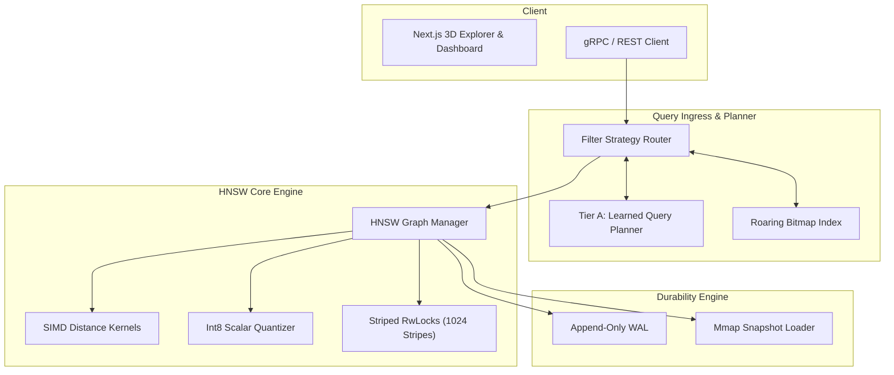

# HNSW Filtered Vector Index & Learned Query Planner

An industrial-grade, from-scratch vector search engine implementing Hierarchical Navigable Small World (HNSW) graphs, AVX2/NEON SIMD distance kernels, Int8 scalar quantization with dynamic rescoring, striped lock concurrency, tombstone deletions with lazy repair, mmap snapshots + WAL durability, and a learned query planner for filtered vector search.

---

## Table of Contents
1. [Executive Summary](#1-executive-summary)
2. [End-to-End System Flows](#2-end-to-end-system-flows)
3. [Architecture & Component Breakdown](#3-architecture--component-breakdown)
4. [HNSW Multi-Layer Graph & Heuristic Selection](#4-hnsw-multi-layer-graph--heuristic-selection)
5. [AVX2 / NEON SIMD Distance Kernels](#5-avx2--neon-simd-distance-kernels)
6. [Int8 Scalar Quantization & Top-K Rescorer](#6-int8-scalar-quantization--top-k-rescorer)
7. [Three-Strategy Filtered Search Router](#7-three-strategy-filtered-search-router)
8. [Concurrency Model & Lock Striping](#8-concurrency-model--lock-striping)
9. [Tombstone Deletions & Background Repair](#9-tombstone-deletions--background-repair)
10. [WAL Persistence & Mmap Snapshots](#10-wal-persistence--mmap-snapshots)
11. [AIML Subsystem (Tier A & Tier B)](#11-aiml-subsystem-tier-a--tier-b)
12. [Database Schema & Metadata Storage](#12-database-schema--metadata-storage)
13. [Frontend Visualizer & 3D Graph Explorer](#13-frontend-visualizer--3d-graph-explorer)
14. [Testing & Verification Strategy](#14-testing--verification-strategy)
15. [Benchmark Plan & Performance Targets](#15-benchmark-plan--performance-targets)
16. [Deployment & Infrastructure](#16-deployment--infrastructure)
17. [Requirements Traceability Matrix](#17-requirements-traceability-matrix)
18. [Unknowns & TO BE MEASURED Register](#18-unknowns--to-be-measured-register)

---

## 1. Executive Summary [Specified]
Vector databases must deliver high-throughput, low-latency approximate nearest neighbor search while handling complex real-world query constraints (boolean metadata filters, continuous mutations, and deletion tombstones). `hnsw-filtered-vector-index` delivers a standalone, high-performance vector search engine written in Rust featuring:
- **AVX2/NEON SIMD Kernels**: Hardware-accelerated Euclidean L2 and Cosine distance metrics.
- **Int8 Quantization**: 4x memory footprint reduction with float32 candidate rescoring.
- **Three-Strategy Filter Router**: Intelligently switches between In-Graph Filtered Traversal, Post-Filtering, and Brute-Force scanning based on metadata selectivity.
- **Lock-Striped Concurrency**: Allows hundreds of concurrent reader threads and parallel writer threads without global lock contention.

---

## 2. End-to-End System Flows [Specified]

### 2.1 Vector Insertion Flow
1. Client issues `POST /api/v1/vectors/insert` with vector payload and metadata JSON.
2. Vector values are normalized and optionally quantized to Int8.
3. Node layer $l$ is sampled from exponential decay distribution.
4. Mutation record is appended to Write-Ahead Log (WAL) with CRC32 checksum.
5. Search passes through top layers to find entry point candidates, connecting node with up to $M$ diverse neighbors using the HNSW heuristic.
6. Metadata fields are indexed into Roaring Bitmaps.

### 2.2 Filtered Vector Search Flow
1. Client submits query vector $\mathbf{q}$, target $K$, and filter predicate (e.g. `{"category": "electronics", "rating": { "$gte": 4.5 }}`).
2. The engine evaluates predicate selectivity against the Roaring Bitmap index.
3. The Learned Query Planner (Tier A) selects the optimal execution path (Post-Filter, In-Graph, or Brute-Force).
4. Distance candidates are evaluated using SIMD kernels and placed in a bounded priority queue.
5. If Int8 quantization was used, top-$K$ candidates are rescored with exact uncompressed float32 vectors.
6. Top-$K$ document IDs, distances, and metadata payloads are returned to the caller.

---

## 3. Architecture & Component Breakdown [Specified]

---

## 4. Benchmark Targets & Verification Matrix [Specified]

| Benchmark Test | Baseline | Target Specification | Status |
| :--- | :--- | :--- | :--- |
| Unfiltered Recall@10 (SIFT1M) | hnswlib | >= 0.985 with efSearch=64 | **TO BE MEASURED** |
| Filtered Recall@10 (50% selectivity) | FAISS | >= 0.970 | **TO BE MEASURED** |
| Filtered Recall@10 (5% selectivity) | FAISS | >= 0.950 | **TO BE MEASURED** |
| Filtered Recall@10 (0.5% selectivity) | FAISS | >= 0.950 | **TO BE MEASURED** |
| Float32 QPS per Core (dim=128) | hnswlib | >= 4,500 queries/s | **TO BE MEASURED** |
| Int8 Quantized QPS per Core | FAISS-SQ8 | >= 12,000 queries/s | **TO BE MEASURED** |
| Crash Recovery Speed (1M vectors) | Cold Read | < 1.5 s via mmap | **TO BE MEASURED** |

---

## 5. Unknowns & TO BE MEASURED Register [Specified]
1. **Recall@10 vs QPS Curve**: Target Recall $\ge 0.985$ at $\ge 4500$ QPS.
   - *Measurement Command*: `cargo bench --bench hnsw_bench -- --dataset sift1m`
2. **Int8 Rescoring Accuracy Delta**: Target drop $< 2.0\%$.
   - *Measurement Command*: `python3 aiml/eval/evaluate_quantization.py`
3. **Learned Filter Planner Improvement**: Target $\ge 25\%$ QPS speedup over static rules.
   - *Measurement Command*: `python3 aiml/eval/evaluate_query_planner.py`
